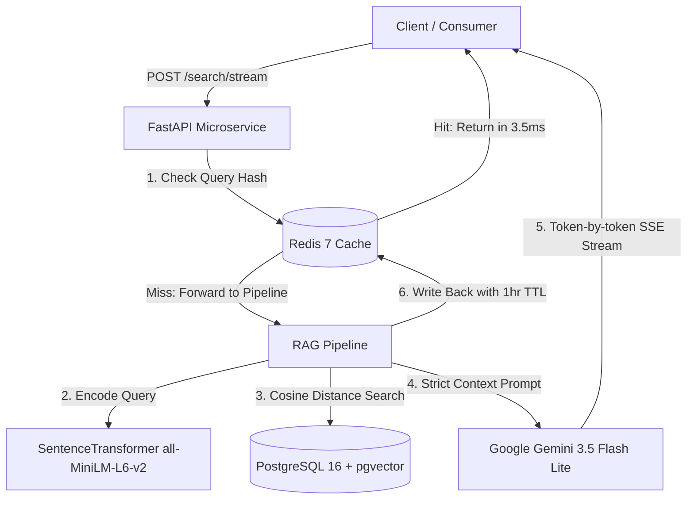

# Enterprise Document Intelligence Microservice (RAG)

An asynchronous Retrieval-Augmented Generation (RAG) microservice built with **FastAPI**, **PostgreSQL (pgvector)**, **Redis 7**, and **Google Gemini**. Engineered for low-latency retrieval, token-by-token SSE streaming, in-memory semantic caching, and quantitative evaluation.


## Benchmarks

### 1. Latency & Caching Performance
Benchmarked via `benchmark.py` measuring end-to-end HTTP retrieval:

| Query State | Retrieval Layer | Latency (p50/avg) | Acceleration |
| :--- | :--- | :--- | :--- |
| Cold Cache Miss | `all-MiniLM-L6-v2` + pgvector SQL | 274.77 ms | Baseline |
| Warm Cache Miss | In-memory Encoder + pgvector SQL | 20.90 ms | 13.1x |
| Redis Cache Hit | Redis 7 (In-Memory RAM) | 3.53 ms | 77.9x |

### 2. Quantitative RAG Evaluation (LLM Judge)
Evaluated across a golden test set using **Gemini-3.5-Flash-Lite** with structured JSON outputs:

| Category | Faithfulness (Anti-Hallucination) | Context Precision | Result |
| :--- | :---: | :---: | :--- |
| Direct Facts | 1.000 (100%) | 1.000 (100%) | Grounded factual retrieval |
| Semantic Paraphrase | 1.000 (100%) | 1.000 (100%) | High embedding generalization |
| Adversarial / Out-of-Domain | 1.000 (100%) | 0.000 (0%) | Strict refusal guardrail enforced |
| Overall Mean | 1.000 (100%) | 0.667 | Zero hallucinations observed |

---

## Architecture



---

## Tech Stack

* **Vector Database**: PostgreSQL 16 with `pgvector`, a unified relational and high-dimensional vector storage without separate database overhead.
* **Embeddings**: `all-MiniLM-L6-v2` loaded locally in RAM via FastAPI Lifespan. This eliminates third-party network latency on vector search.
* **Cache-Aside Layer**: Redis 7 Alpine with sub-5ms responses for repeated queries.
* **Streaming Protocol**: Server-Sent Events (SSE) via `sse-starlette` for immediate Time-to-First-Token (TTFT).

---

## Quickstart

### 1. Prerequisites
```bash
# Clone the repository and configure environment variables
cp .env.example .env  # Add your GEMINI_API_KEY

# Spin up Postgres and Redis containers
docker compose up -d postgres redis
```

### 2. Ingest Sample Documentation
```bash
.venv/Scripts/python ingest.py
```

### 3. Run the Quantitative Evaluation Suite
```bash
.venv/Scripts/python evaluate.py
```

### 4. Run the Latency Benchmark
```bash
# Terminal 1: Launch API
.venv/Scripts/uvicorn main:app --port 8000

# Terminal 2: Run benchmark
.venv/Scripts/python benchmark.py
```
